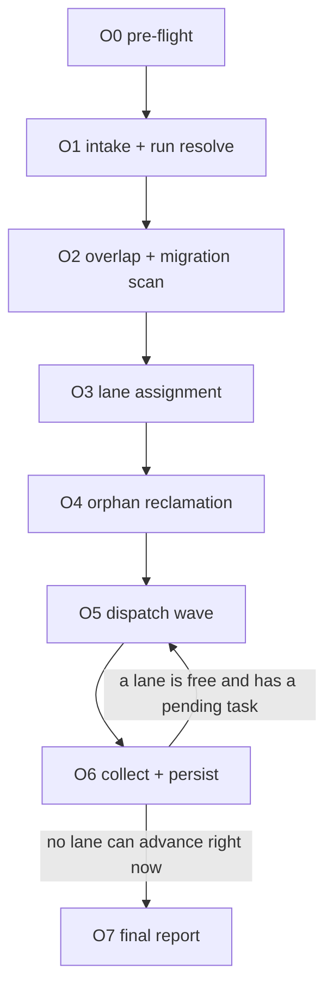

# orchestrate — bounded concurrent `task` fan-out

You are the **pool manager**, not a second pipeline. You never plan, implement, or review
code yourself, and you never edit a worktree. Every unit of work is a full, unmodified run
of `.agents/skills/task/SKILL.md`, dispatched as an isolated subagent. You hold only a small
status record per task — never that task's diff, plan, or transcript.

## Invocation

`orchestrate <items...> [--concurrency=N] [--gate=manual|auto] [--run=<id>] [--strict-overlap]`

Typed as `/orchestrate …` in Claude Code and `$orchestrate …` in Codex; the arguments are
identical.

| Argument | Meaning | Default |
|---|---|---|
| `<items>` | The backlog. See **Input forms** below. | required |
| `--backlog=<path>` | Read items from a file instead of inline args. | — |
| `--label <name>` | Repeatable. Source the backlog from open issues carrying every named label (AND). | — |
| `--milestone <name>` | Source the backlog from open issues in the named milestone. | — |
| `--concurrency=N` | Max tasks in flight at once. | **3** |
| `--gate=manual\|auto` | Forwarded verbatim to every `task` dispatch unless a line overrides it. | `auto` |
| `--run=<id>` | Pin the run id for resume. Omit to derive one deterministically. | derived |
| `--strict-overlap` | Refuse file-overlapping tasks instead of serializing them. Never applies to migrations — those are always serialized, no override. | off |

**Input forms** (pick one):
1. Inline arguments, one task per line (a multi-line string or heredoc-style argument).
2. A `-`/`*` bulleted list, inline or in a file — the bullet marker is stripped.
3. `--backlog=<path>` — a plain-text or markdown-checklist file, one task per line. Blank
   lines and lines starting with `#` are ignored. A `- [x]` checked line is skipped (treated
   as already handled outside this run); `- [ ]` and unmarked lines are work items.
4. The issue tracker. `--label <name>` (repeatable, AND semantics) and/or
   `--milestone <name>` pull the queue from
   `gh issue list --state open --label <l> --json number,title,labels,url` (one `--label`
   per name) or `gh issue list --state open --milestone "<name>" --json number,title,labels,url`;
   an explicit `#12 #14 #19` argument list pulls exactly those issues via
   `gh issue view <n> --json number,title,body,labels,state,url`. Either way, every issue
   found is run through the **eligibility filter** (below) before it becomes a task: each
   surviving issue's task description is the literal string `task #<n>` — `task` itself
   parses the frozen issue body headings — and its row carries `issue_number: <n>`.

Each line may end with its own `--gate=` override, which wins over the run default for that
task only. Issue-sourced tasks have no line to annotate this way and always use the run's
`--gate`.

## Concurrency default: 3, and why

Each in-flight task provisions a **full docker compose stack** via `task_env.py up`
(db + api + frontend). Port allocation (`PORT_SCAN_LIMIT=400` per service) is not the
binding constraint — host CPU/memory for N concurrent compose stacks, and the number of
high-capability subagents you can dispatch and later reconcile without silently losing track
of one, are. Three is the largest pool that keeps every in-flight PR reviewable by a human at
`--gate=manual` without a backlog of unread gate reports, and matches `task`'s own
conservatism about round counts. Raise `--concurrency` on a beefier box; lower it to 1 to
force strict sequential processing without changing anything else about this skill.

## Issue eligibility and dependency graph

This is reference material for **O1** (fetch + filter), **O2** (graph construction), **O3**
(lane admission) and **O5/O6** (write-back) below — it adds no nodes of its own.

**Eligibility filter.** An open issue is a dispatch candidate only if every clause holds,
checked in order, and the first failing clause is recorded as the rejection reason:
0. **Is actually an issue.** For an explicit `#<n>` argument, `gh issue view <n> --json
   number,state,title,url` exits 0 for a pull request number too — GitHub models PRs as
   issues, so this check exists precisely because `gh issue view` cannot be trusted to
   reject one on its own. Reject unless the returned `.url` contains `/issues/`; a `.url`
   containing `/pull/` is rejected as `not-an-issue:#<n>`, regardless of `.state` (a merged
   PR reports `MERGED`, but an open PR reports `OPEN` exactly like an eligible issue would,
   so `state` alone is not the check). `--label`/`--milestone` sourcing never needs this
   clause — `gh issue list` cannot return a PR.
1. `state: OPEN` — `gh issue list --state open` already restricts to this; an explicit
   `#<n>` argument is still checked with `gh issue view <n> --json state`.
2. Carries the flow label `agent-ready`.
3. Does not carry `blocked` or `needs-triage`.
4. Every `Depends on #<n>` parsed from the body (see **Dependency graph** below) is
   resolved.
5. No open PR already references it: `gh pr list --search "<n> in:body" --state open --json
   number,url` returns empty.
A rejected issue is never dropped silently. It is recorded in O1 with its clause
(`not-an-issue:#<n>`, `not-agent-ready`, `blocked-label`, `needs-triage`,
`unmet-dependency:#<n>`, or `open-pr:#<pr>`) and surfaced again in O7's final report.

**Dependency graph.** For every candidate issue, grep its body for `Depends on #<n>`
(one or more, case-insensitive). Each match is an edge `issue -> dependency`. A dependency
is **resolved** only when a PR referencing it has merged:
```
gh pr list --search "<n> in:body" --state all --json number,state,url
```
Any returned PR with `state: MERGED` resolves the edge. A returned PR with `state: OPEN`
means the dependency is open-but-unmerged — refuse to dispatch the dependent issue this
invocation (`status: "blocked-on-merge"`, `failure_reason: "depends on open PR <url>"`) and
re-check on the next O5/O6 pass or the next invocation. No PR found yet is the same
refusal: the dependency has simply not started.

**Cycle detection.** Walk the graph before any dispatch. A cycle among candidate issues is
a **fail-stop for the whole run** — report the full chain and dispatch nothing in the cycle
or downstream of it. A cycle can never resolve on its own; unlike a migration or
file-overlap lane, it is not something a later invocation can retry through.

**Migration lane vs. dependency graph — two independent constraints, not one subsuming the
other.** A migration-touching issue is serialised against every other migration-touching
issue (the migrations lane, unchanged, in O3) regardless of its declared `Depends on`
edges — the lane order is backlog order, not graph order, and applies even when the issue
names no dependency at all. It must, in addition, still wait on its own declared
dependencies to merge, even when those dependencies do not touch a migration. A
non-migration issue with no declared dependency is never held up by the migrations lane.
Do not re-derive one rule from the other.

**Re-evaluation.** The ready set is not fixed at O1. Every time O6 records a `passed`
result, re-walk the dependency graph for any issue whose only blocker was that PR merging —
this is the same O6→O5 drain loop described in **the graph** below, extended to dependency
edges as well as lane heads.

## The graph — this is the order authority



**Track one todo per node.** Create the whole list at O0.

```
O0 pre-flight              O4 orphan reclamation
O1 intake + run resolve    O5 dispatch wave
O2 overlap scan            O6 collect + persist
O3 lane assignment         O7 final report
```

O5↔O6 is the pool's drain loop, not a failure loop-back — it repeats every time a slot frees
and the backlog still has eligible work, within the same invocation, until nothing more can
be started right now.

## Invariants

- **You never touch a worktree, branch, or compose project directly**, except read-only
  inspection (`git worktree list`, `docker compose ls`, `task_env.py status`) for orphan
  reclamation. `task` owns all of that; duplicating it here is how two owners collide.
- **State lives on disk**, at `${TMPDIR:-/tmp}/orchestrate-runs/<run-id>/state.json`, outside
  every worktree and outside `task`'s own `${TMPDIR:-/tmp}/task-qa/` state root. If your
  context is compacted or this invocation is a resume, re-read it before acting.
- **Each `task` run is dispatched as its own subagent** with a fresh context on the
  highest-capability model available — it performs the entire `task` orchestrator role, the
  same reason `task` pins that capability for its own implementer and QA. Give it nothing but the template in **O5**. Take back nothing but
  the one-block report in **O6**. Never paste a task's plan, diff, or check output into your
  own context or into another task's dispatch.
- **A run-scoped lock** at `$STATE_DIR/lock` (pid + timestamp) prevents two orchestrate
  invocations from double-dispatching the same run. Refuse to start if a live lock is younger
  than 2 hours; otherwise treat it as abandoned and proceed.
- **Teardown is `task`'s job, always**, per its own T11. Your orphan reclamation (O4) exists
  only to catch what a *killed* orchestrate or `task` subagent — one that never reached
  T11 — left behind. It is a safety net, not the primary teardown path.
- **Never dispatch a task whose predicted worktree/branch already has an unresolved state**
  you have not read. Predicted paths come from `task_env.py slug`, which is a pure function
  of the description — compute it once, pin it in `state.json`, and reuse it forever for that
  task, including across resumes on a different calendar day.
- **Issue comments are a projection, never a second store.** `state.json` is written first;
  a `gh issue comment` call happens only after the row it describes is already persisted.
  A failed comment post is logged and ignored, not retried by reading GitHub state back into
  `state.json` — the run-state file stays the one source of truth.

## O0 — pre-flight
**Purpose.** Fail before touching disk if the toolchain is missing.
**Do.** `git --version; gh auth status; docker compose version; python3 --version` plus
`git -C "$(git rev-parse --show-toplevel)" worktree list`.
**Exit.** All present, `gh` authenticated.
**On failure.** Hard stop, list what is missing. Never auto-install.
**Produces.** One todo per node.

## O1 — intake + run resolve
**Purpose.** Fix the backlog and the run identity before any dispatch exists.
**Do.**
```
ROOT=$(git rev-parse --show-toplevel)
RUN=${RUN_OVERRIDE:-"$(date -u +%F)-$(printf '%s' "$RAW_INPUT" | sort | shasum -a 1 | cut -c1-8)"}
STATE_DIR="${TMPDIR:-/tmp}/orchestrate-runs/$RUN"
mkdir -p "$STATE_DIR"
printf '%s\n' "$RAW_INPUT" > "$STATE_DIR/backlog.txt"
```
`$RAW_INPUT` is the parsed, one-task-per-line backlog per **Input forms** (bullets and
comments stripped). If `$STATE_DIR/state.json` already exists, this is a **resume**: load it
instead of building a fresh one, and skip straight to O4 with the existing task list — do not
re-run O2/O3 on tasks that already have a lane and a status. Only merge in genuinely new lines
(present in the fresh backlog, absent from the loaded state) through O2/O3.
Write the lock: `printf '%s %s\n' "$$" "$(date -u +%FT%TZ)" > "$STATE_DIR/lock"`.
For a fresh run, seed `state.json`:
```json
{
  "run_id": "<RUN>",
  "gate_mode": "auto",
  "concurrency": 3,
  "strict_overlap": false,
  "tasks": [
    {
      "id": "t1",
      "description": "<verbatim line>",
      "issue_number": null,
      "slug": "<task_env.py slug output>",
      "date_pin": null,
      "migration": false,
      "lane": null,
      "status": "pending",
      "commented_pickup": false,
      "worktree": null,
      "branch": null,
      "pr_number": null,
      "pr_url": null,
      "gate1": null,
      "gate2": null,
      "failure_reason": null,
      "evidence_path": null,
      "started_at": null,
      "finished_at": null
    }
  ]
}
```
Compute `slug` for every task now via `python3 "$(git rev-parse --show-toplevel)"/.agents/skills/task/scripts/task_env.py slug "<description>"`
— never hand-derive it; it must agree with what `task` itself will compute at its own T1.

**Issue-sourced backlog.** When the invocation is `--label`, `--milestone`, or an explicit
`#<n>` list instead of free-text lines, fetch first:
```
gh issue list --state open --label <l> --json number,title,labels,url
gh issue list --state open --milestone "<m>" --json number,title,labels,url
gh issue view <n> --json number,title,body,labels,state,url
```
Run every issue returned through the **eligibility filter** (see **Issue eligibility and
dependency graph** above) before it becomes a line of `RAW_INPUT`. Each surviving issue
becomes one task with `description: "task #<n>"` and `issue_number: <n>` set on its row;
derive its `slug` from the issue title (`task_env.py slug "<issue title>"`), not from the
literal string `task #<n>`, so the predicted worktree path stays stable and legible. Append
every rejected issue as a comment line in `$STATE_DIR/backlog.txt`
(`# rejected #<n>: <clause>`) so a resumed run still has the rejection on hand for O7.
**Exit.** `state.json` exists, every task has an `id` and a `slug` (and an `issue_number`
where the backlog came from the tracker), the lock is held.
**On failure.** A live lock younger than 2 hours → stop, report who holds it, do not proceed.

## O2 — overlap + migration scan
**Purpose.** Flag tasks that will conflict at merge before either one is dispatched. This is
static and cheap — no subagent, no LLM call.
**Do.** For every task new to this run, using the description for a free-text task or the
fetched issue title + body for an `issue_number` task (`task #<n>` itself carries no
signal to scan):
1. **Migration tag.** Match the source text case-insensitively against
   `\b(migration|alembic|schema|column|drop table|new table|rename table|add.*model|model field)\b`.
   Any hit → `migration: true`.
2. **Predicted file hits.** Extract tokens ≥4 chars, minus stopwords, from the source text.
   Keep only tokens that also occur as a file or directory basename under `backend/app` or
   `frontend/src`:
   ```
   git -C "$ROOT" ls-files backend/app frontend/src | xargs -n1 basename | sort -u
   ```
   Grep the repo for the surviving tokens to get each task's predicted hit set:
   ```
   git -C "$ROOT" grep -liE '(tok1|tok2|...)' -- backend/app frontend/src
   ```
3. **Pairwise overlap.** Two non-migration tasks overlap when their predicted hit sets
   intersect. Record the pair.
4. **Dependency graph.** For every `issue_number` task, parse `Depends on #<n>` out of its
   issue body and add the edge to `state.json`'s `dependency_graph` (an adjacency list keyed
   by issue number). Detect cycles now, before any lane exists — see **Issue eligibility
   and dependency graph** above for how an edge is later resolved at dispatch time.
This is a heuristic, not a guarantee — it exists to catch the common case (two tasks naming
the same router, model, or component) cheaply, not to prove independence formally.
**Exit.** Every task has `migration` set, every overlapping pair is recorded, and the
dependency graph, if any, is acyclic.
**On failure.** A cycle among candidate issues → hard stop the whole run, report the full
chain, dispatch nothing in it or downstream of it. This is the one case where O2 itself can
end the run.
**Produces.** The overlap-pair list, the migration-tagged set, and the dependency graph,
consumed by O3.

## O3 — lane assignment
**Purpose.** Turn overlap findings into a dispatch order that cannot produce two colliding
merges. A lane is a strict FIFO queue; different lanes run concurrently, up to `--concurrency`.
**Do.**
- **Migrations lane, mandatory, no override.** All `migration: true` tasks go into one lane,
  `lane: "migrations"`, in backlog order. `alembic` has one linear head; two worktrees
  branched from the same `origin/main` each adding a revision will produce two heads the
  moment both merge, regardless of whether their code changes overlap. Serializing *dispatch*
  is not enough — the next migration task must not even be dispatched until the previous
  migration task's PR has actually **merged** into `origin/main`, not merely reached
  ready-for-review. Gate its admission on:
  ```
  gh pr view <prev-pr-number> --json state --jq .state
  ```
  `MERGED` → admit the next migration task. `OPEN` → leave it `status: "blocked-on-merge"`
  and do not dispatch it this invocation; a later invocation re-checks. `CLOSED` (abandoned,
  unmerged) → stop and report to the human; do not auto-advance the lane.
- **Dependency admission, orthogonal to lanes.** A task with one or more `Depends on #<n>`
  edges is queued into its lane as normal, but at the moment it would otherwise be
  dispatched (O5) every edge is re-checked per **Issue eligibility and dependency graph**
  above. Any edge unresolved → `status: "blocked-on-merge"`; it stays at the head of its
  lane (blocking whatever else is queued behind it, exactly like a migration awaiting merge)
  and dispatch moves to the next eligible lane instead. This applies whether or not the task
  is also in the migrations lane — the two constraints stack, neither replaces the other.
- **File-overlap lanes.** For every recorded overlapping pair, put both tasks in one shared
  lane (union overlapping pairs transitively into groups), FIFO by backlog order. Admission
  into the next slot only requires the previous lane member to reach any terminal status
  (`passed`, `hard-stop`, `gate1-fail`, `gate2-fail`) — unlike migrations, nothing here
  requires a merge, because two open, un-merged branches touching the same file do not
  corrupt each other; the risk is a messy merge later, which serialized *dispatch order*
  already reduces, and a human resolves the rest at merge time.
- With `--strict-overlap`: skip the shared-lane construction for file overlaps (never for
  migrations) and instead mark every task in an overlapping pair `status: "blocked-overlap"`,
  `failure_reason: "overlaps with <other task id>; rerun with default serialization or split the work"`.
  Do not dispatch them.
- Every task touched by neither rule gets its own singleton lane — it runs the moment a pool
  slot is free.
**Exit.** Every non-blocked task has a `lane`. Persist `state.json`.

## O4 — orphan reclamation
**Purpose.** Reclaim what a killed `task` or `orchestrate` process left behind, from *this*
run or any other. Runs on every invocation, before dispatching, because it is cheap and the
alternative is silent port/worktree exhaustion.
**Do.** List candidates:
```
find "${TMPDIR:-/tmp}/task-qa" -maxdepth 1 -mindepth 1 -type d -mmin +240
docker compose ls --format '{{.Name}}' | grep '^task-'
git -C "$ROOT" worktree list --porcelain | awk '/^worktree /{print $2}' | grep '/.task-worktrees/'
```
A candidate slug is an **orphan** only if it is both older than 4 hours (the `-mmin +240`
filter, or the worktree's directory mtime) **and** absent from every non-terminal task in
every `${TMPDIR:-/tmp}/orchestrate-runs/*/state.json` — i.e. no live run, including this one,
still claims it. Never reclaim a slug that any run's state file lists as `pending`,
`dispatched`, or `blocked-on-merge`.
Before removing a worktree, check it is safe:
```
git -C "<worktree>" status --short
git -C "<worktree>" log @{u}.. --oneline
```
Non-empty either way → **stop, report, do not remove.** Unpushed or uncommitted work is never
destroyed silently. Otherwise:
```
python3 "$(git rev-parse --show-toplevel)"/.agents/skills/task/scripts/task_env.py down --task <slug>
git -C "$ROOT" worktree remove "<worktree>" --force
git -C "$ROOT" worktree prune
```
`task_env.py down` refuses any project not prefixed `task-` and requires an explicit
`--task`, so this can never reach the developer's main stack.
**Exit.** No orphan candidate remains that met both conditions.
**On failure.** A candidate with unsafe state → leave it, name it in the final report.

## O5 — dispatch wave
**Purpose.** Fill every free pool slot with the next eligible task, then dispatch all of them
in one request so they run concurrently (the wave waits for the whole batch to return before
you can see any of it, which is why this is a wave, not a stream — refill happens in the
O5↔O6 loop instead).
**Do.** A slot is free when fewer than `--concurrency` lanes currently have a task
`status: "dispatched"`. For each free slot, in lane order: take the head of the first lane
with a `pending` task and no task currently `dispatched`. For a task never dispatched before,
set `date_pin = date -u +%F` now and freeze it in `state.json` — every later redispatch of
this same task reuses this value, so paths stay stable across a resume that crosses midnight.
For a task with an `issue_number`, immediately before dispatch, re-check
`gh pr list --search "<n> in:body" --state open --json number,url`. A non-empty result
means another run claimed it since O1/O2 ran — leave it `pending`, skip it this wave, and
let the next O5 pass re-evaluate it. Otherwise, if `commented_pickup` is not yet `true`,
claim it: `gh issue comment <n> --body "Picked up by orchestrate run <RUN>, task <id>."`,
then set `commented_pickup: true` and persist `state.json` before dispatching — the comment
is the claim signal, so it must land before the subagent starts, and it is never repeated on
a later redispatch of the same task.
Dispatch each chosen task as one general-purpose subagent with a fresh context
(high-capability model), all in a single request covering the whole wave. Prompt, verbatim except the placeholders:
```
Follow .agents/skills/task/SKILL.md exactly, end to end, for this work item. Do not ask
about scope; the description below is the whole task.

Task: <verbatim description>
Gate mode: --gate=<auto|manual>
Pinned DATE for T1: <date_pin> — use this exact value, do not compute today's date.

If <ROOT>/../.task-worktrees/<date_pin>-<slug> already exists and contains
.tasks/<date_pin>-<slug>.md, this is a resume: cd into that worktree, read the task file's
progress log, and continue from the last logged node instead of starting at T0.

When you finish — success, a gate failure, or a hard stop — return exactly one block and
nothing else:
STATUS: passed | gate1-fail | gate2-fail | hard-stop
PR: <number and URL, or none>
WORKTREE: <absolute path if kept, or removed>
REASON: <one line, only if not passed>
```
Mark each dispatched task `status: "dispatched"`, `started_at: now`, persist `state.json`
immediately — a crash between dispatch and collection must find these as resumable, not lost.
**Exit.** Every free slot this pass either got a task or had none eligible.
**Produces.** The wave's subagent results, arriving together in O6.

**Claim safety.** The pre-dispatch re-check plus the pickup comment above are the whole
mechanism — there is no server-side lock on an issue. The residual race: two orchestrate
runs (or a human and a run) can both pass the re-check within the same few seconds, before
either comment lands, and both dispatch against the same issue. Nothing here prevents that;
it is caught downstream, not avoided — the loser's `task` run still opens its own PR, and a
human reconciles two PRs for one issue at merge time. Closing the gap fully would need an
atomic claim (a label add, a lock issue) that this skill does not implement; this note exists
so an operator knows to look for a duplicate PR rather than assume the race cannot happen.

## O6 — collect + persist
**Purpose.** Turn each subagent's one report block into a state update, without absorbing
anything else it may have said.
**Do.** For each returned result, parse the `STATUS:`/`PR:`/`WORKTREE:`/`REASON:` block only.
Update that task's row: `status`, `pr_number`, `pr_url`, `worktree`, `failure_reason`,
`finished_at`. Derive `gate1`/`gate2` from `status` (`gate1-fail` → G1 failed, G2 never run;
`gate2-fail` → G1 passed, G2 failed; `hard-stop` → record which gate was in progress from the
reason line; `passed` → both green). Release the task's lane. Persist `state.json`.
For a task with an `issue_number`, comment the outcome after the row is persisted:
`gh issue comment <n> --body "<status>: <one-line reason if not passed>, <PR url if any>"`.
The comment reflects the row just written; a failed post is logged and skipped, never a
reason to stop the run.
**Exit.** Every wave member has a terminal or `blocked-on-merge` status recorded.
**Loop.** If any lane now has a free head and a `pending` (or a `blocked-on-merge` that just
became admittable — re-check `gh pr view` for the migrations lane, or the dependency-edge
check in **Issue eligibility and dependency graph** for a graph-blocked task) task, return to
**O5**. Otherwise fall through to **O7**.

## O7 — final report
**Purpose.** One table, everything a human or the external loop needs, nothing they must dig
for.
**Do.** Release the lock (`rm "$STATE_DIR/lock"`). Print a table: task, status, PR link, G1,
G2, and — for anything not `passed` — the failure reason and where the evidence lives (task
file path if the worktree was kept, PR URL, or the QA handoff dir at
`${TMPDIR:-/tmp}/task-qa/<slug>/`). Then one line: how many tasks remain `pending` or
`blocked-on-merge`, and that re-invoking `orchestrate` with the same `--run=<id>` (or letting
the external loop do so) resumes exactly them.
For an issue-sourced run, print a second short table from the `# rejected #<n>: <clause>`
lines in `$STATE_DIR/backlog.txt` — every issue the eligibility filter turned away, with the
clause that rejected it. Rejection is a line in this report, never a silent drop.
**Exit.** Report printed. State file is the durable record; do not delete it.

## Resumability

`state.json` is the entire memory of a run. Resume procedure, always safe to run cold:
1. `RUN=<id>`; if unknown, `ls "${TMPDIR:-/tmp}/orchestrate-runs/"` and pick by recency.
2. Load `state.json`. Any task `status: "dispatched"` with no terminal result means the prior
   orchestrate process died mid-wave, not that the task itself failed. Re-dispatch it exactly
   as in O5, using its **already-pinned** `slug` and `date_pin` — the resume clause in the
   dispatch prompt handles a worktree that already exists.
3. Skip every `passed`/`gate1-fail`/`gate2-fail`/`hard-stop` task entirely. This is what makes
   a re-invocation idempotent: nothing already terminal is ever redispatched.
4. Re-run O4 (orphan reclamation is always safe and cheap) before O5.
5. Continue the O5↔O6 loop from wherever the lanes stand.

A single invocation is one call to this procedure: drain everything currently dispatchable,
report, exit. The external loop's only job is to call `orchestrate --run=<id>` again later —
it owns pacing (how often, whether to add new backlog lines to the same run via `--backlog=`),
never the pool logic, lane logic, or gate logic, all of which live here and in `task`.

## Failure isolation

One task's `gate1-fail`/`gate2-fail`/`hard-stop` never aborts the run. Concretely:
- **Worktree.** `task` keeps it on any failure path (its own T11 invariant) — you do not
  remove it. It is where the human resumes.
- **Compose project.** `task`'s T11 always runs `task_env.py down --task <slug>`, win or
  lose — teardown is unconditional, only the worktree survives.
- **Branch/PR.** Whatever existed at the point of failure stays exactly as `task` left it: no
  PR if it failed before T9, a draft PR if it failed at G2 (QA never flips it ready), pushed
  commits regardless. You never merge, close, or edit a PR.
- **Lane.** The slot is released in O6 like any terminal status; later tasks in the same lane
  proceed normally — a failed task was never merged, so it cannot poison a peer's merge base.
- **Report.** Every failure appears in O7 with its reason and evidence path. Nothing failed is
  ever silently dropped from the table.

## Files in this skill

| File | Role |
|---|---|
| `.agents/skills/orchestrate/SKILL.md` | This file. The pool graph, the nodes, the lane and resume rules. |

No companion script: slug derivation and environment teardown are `task`'s
`.agents/skills/task/scripts/task_env.py`, reused as-is (`slug`, `status`, `down`) so the two
skills can never disagree about a task's identity.

## Harness notes

The procedure above is harness-neutral. These are the only provider-specific bindings.

### Claude Code

- Invoked as `/orchestrate …`. Each wave is several `Agent` calls in a single message,
  `subagent_type: "general-purpose"` with `model: "opus"`. `context: fork` is **not** used —
  each task subagent must start from a fresh context, or the isolation this skill exists for
  is gone.
- Track the node list with the todo tool.

### Codex

- Invoked as `$orchestrate …`. Dispatch a wave by requesting several subagents in natural
  language in one turn, naming the role defined under `.codex/agents/` where one applies;
  `.codex/config.toml` raises `[agents] max_concurrent_threads_per_session` so a wave is not
  serialized.
- Subagents inherit the parent session's `AGENTS.md` snapshot, and Codex loads nested
  `AGENTS.md` only for the directory the session launched in — **start the session at the
  repository root**.
- Codex reads only `name` and `description` from this skill's frontmatter, and there is no
  `Stop` hook on this skill: persist `state.json` and print the final report yourself before
  finishing.
