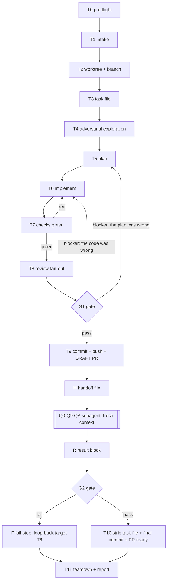

# task — two-gate development pipeline

You are the **orchestrator**. You plan, dispatch, gate and report. After T6 you do not
write product code yourself; subagents do. Everything durable is written to disk.

## Invocation

`task <free-text description of the work> [--gate=manual|auto]`

Typed as `/task …` in Claude Code and `$task …` in Codex; the arguments are identical.

| Argument | Meaning | Default |
|---|---|---|
| `<description>` | The whole task. This is the only source of intent — there is no ticket system. | required |
| `--gate=auto` | Human approval pauses are demoted to log-and-continue. Failures still hard-stop. | **default** |
| `--gate=manual` | G1 pauses for explicit human approval before the QA phase begins. | — |

Honour the prose equivalents: "stop and show me the plan before QA" = `--gate=manual`.
If `<description>` is empty or is a question rather than a piece of work, stop and ask —
do not invent a task.

## The graph — this is the order authority

Follow the graph. Do not improvise the order. Do not merge two nodes because they
"belong together".



**Track one todo per node.** Create the whole list at T0, before doing anything else,
exactly as below. A skipped node then shows up as a missing checkbox instead of a silent
shortcut.

```
T0 pre-flight            T6 implement              H  handoff file
T1 intake                T7 checks green           Q  QA phase (subagent)
T2 worktree + branch     T8 review fan-out         G2 QA gate
T3 task file             G1 review gate            T10 finalize PR
T4 exploration           T9 draft PR               T11 teardown + report
T5 plan
```

Mark a node completed only when its **exit condition** below is met. On a loop-back,
reopen the target node's todo and every node between it and where you are.

## Invariants

- **Worktrees are mandatory.** Never edit, commit or run a check in the main checkout.
- **State lives on disk.** `.tasks/<date>-<slug>.md` in the worktree plus the handoff file
  outside it. If context is compacted, re-read those files and resume from the last logged
  node. Never rely on remembering.
- **Append to the task file's progress log at every node.** One line:
  `- [T7] <ISO-8601 UTC> — backend+frontend checks green`.
- **Every path ends in teardown** (T11), including every failure path.
- **A check you did not run is UNVERIFIED, not PASS.** Never report a check you did not
  execute in this run, and never paste output you did not see.
- **Never `git commit --no-verify`.** `.githooks/pre-commit` is change-scoped and fast
  (backend: ruff format + lint; frontend: the Node pin, then prettier + eslint on the staged files;
  no test suite). It is a
  smoke gate, not the real gate — T7 is. If the hook fails, the work is not done.
- **Never end a turn with live background work.** Evidence-producing suites run in the
  foreground. "It is still running" is not an acceptable final answer.
- **Subagent capability is explicit on every dispatch.** `backend-reviewer`,
  `frontend-reviewer` and `uncle-bob` keep the model their own harness definition pins — do
  not override it. The implementer and the QA subagent are general-purpose subagents with a
  fresh context and MUST run on the highest-capability model available.
- **Shell variables below are shorthand.** Bash tool calls do not share state: re-derive
  `$ROOT`, `$WT`, `$SLUG`, `$DATE`, `$BRANCH`, `$STATE` (or inline the literal paths) in
  every call, and re-run the `task_env.py env --export` eval in any call that needs
  `DATABASE_URL`.
- **Loop counters.** T6↔T7 max 3 rounds. G1 loop-back max 2 rounds. QA's internal fix loop
  max 5. On exhaustion: stop and return to the human with the evidence.

## Gate modes

| | `--gate=auto` (default) | `--gate=manual` |
|---|---|---|
| G1 passes (all checks green, zero unresolved BLOCKERs) | log the evidence, continue to T9 | log the evidence, **pause** for human approval, then T9 |
| G1 has a BLOCKER or a red check | **hard stop**, loop back per the graph | **hard stop**, loop back per the graph |
| G2 QA verdict PASS | continue to T10 | continue to T10 |
| G2 QA verdict FAIL | **unconditional stop, return to the human** | **unconditional stop, return to the human** |

Auto mode never removes a fail-stop. A red QA verdict always comes back to a human,
with or without `--gate=auto`.

## Repo checks — the exact commands

Run from the **worktree**, per side, with the isolated task environment's variables
exported (see T7). These are the commands CI and `.githooks/pre-commit` run; there are no
others.

| Side | Directory | Commands, in order |
|---|---|---|
| backend | `backend/` | `uv run ruff format --check .` · `uv run ruff check .` · `uv run mypy app` · `uv run alembic upgrade head` · `uv run alembic check` · `uv run pytest -n 4` |
| frontend | `frontend/` | `npm run lint` · `npm run typecheck` · `npm run format` · `npm run test` · `npm run build` |

Facts you must not rediscover the hard way:

- `alembic check` and `alembic upgrade head` **require a live PostgreSQL** and a valid
  `DATABASE_URL` + `AUTH_JWT_SECRET`. Without them they crash on settings validation.
- Without `DATABASE_URL`, `pytest` reports `55 passed, 24 skipped` — the integration tier
  silently does not run. A backend gate on skipped integration tests is not a gate. Always
  export the task env first.
- `npm run typecheck`, `test` and `build` each re-run `generate:api` (orval) from
  `backend/openapi.json`. `frontend/src/lib/api/generated/` is gitignored — never commit it.
- `npm run format` is `prettier --check`. To fix: `npm run format:write`.

## Nodes

### T0 — pre-flight
**Purpose.** Fail now, not at T9, if the toolchain is missing.
**Do.** One chained Bash call:
`git --version; gh auth status; docker compose version; uv --version; node --version; npm --version`
plus `git rev-parse --show-toplevel` and `git remote get-url origin`.
**Exit.** All present, `gh` authenticated, an `origin` remote exists.
**On failure.** Hard stop. List exactly what is missing and how to install it. `gh` missing
or unauthenticated is always fatal — T9 calls `gh pr create` on every run — and is fatal
earliest when the invocation is an issue (`task #123`), since T1's `gh issue view` needs it
first. Fix with `gh auth login`. **Never auto-install anything.** Never continue "without
the PR step".
**Produces.** One todo per node.

### T1 — intake
**Purpose.** Fix the task text, its source, and the mode before any state exists.
**Do.** Parse `--gate`. Classify the invocation argument, in this priority order:

1. **Issue reference** — `#<issue>`, a bare `<issue>`, or a full issue URL. `gh` accepts
   all three forms directly, no extraction step needed:
   ```
   gh issue view <issue> --json number,title,body,labels,url,state
   ```
   Parse and validate it per **Issue intake** below before anything else touches state.
2. **Path to an existing task file** — unchanged: capture the text verbatim as the
   description.
3. **Free prose** — unchanged: capture the text verbatim as the description, exactly as
   before.

Then, exactly:
```
DATE=$(date -u +%F)
SLUG=$(python3 "$(git rev-parse --show-toplevel)"/.agents/skills/task/scripts/task_env.py slug "<the description>")
BRANCH="task/$DATE-$SLUG"
```
For an issue (form 1), derive `SLUG` and `BRANCH` instead as:
```
SLUG="<issue>-$(python3 "$(git rev-parse --show-toplevel)"/.agents/skills/task/scripts/task_env.py slug "<title, [Type] prefix stripped>")"
BRANCH="<type>/$SLUG"
```
`<type>` is the issue's type label mapped `feature`→`feat`, `bug`→`fix`, `chore`→`chore`,
`docs`→`docs`, `spike`→`spike` — matching the `<type>/<issue-number>-<kebab-slug>`
convention `CONTRIBUTING.md` already mandates for issue-driven branches. Never invent the
slug by hand — `task_env.py slug` is still the only function that produces it; the compose
project, the branch, the task file and the state directory must all agree.

**Issue intake.** Split the body on `^### ` headings — the frozen issue-body contract's H3
labels, matched character for character. A section whose text is exactly `_No response_`
is absent; that is what GitHub writes for an unanswered optional field, not a value.

| Heading | Role |
|---|---|
| `What is it` | The task summary. |
| `Specs` (feature/chore/spike forms) | The requirements the plan must satisfy. |
| `Observed behaviour` + `Expected behaviour` + `Reproduction` (bug form) | Together play the role `Specs` plays elsewhere — no bug form has a `Specs` heading. |
| `Acceptance criteria` | The checklist G2 verifies against, verbatim. |
| `Pre-exploration` (optional) | A head start for T4 — never a substitute for exploring, never trusted without verification. Stale pre-exploration is the most likely way this pipeline produces a wrong change: **T4 must verify every file path and claim it inherits and report any that are wrong.** |
| `Out of scope` (optional) | A hard boundary. Work that drifts into it fails G1. |
| `Related documents` (optional) | Repo-relative paths to read before planning, typically a PRD under `docs/prds/`. |
| `Area` | `backend` / `frontend` / `full-stack` / `devops` / `security`, `multiple: true`. Feeds T5's Scope: backend → backend-reviewer, frontend → frontend-reviewer, full-stack → both, devops or security → both plus extra scrutiny on auth/secrets/dependency paths; uncle-bob always runs regardless. T8's dispatch itself is unchanged (still purely changed-path based, so it stays provider-agnostic) — make sure T5's Scope is wide enough that the Area's implied paths are actually in scope. |

Compose the Description from, in order, each its own paragraph: `What is it`; then `Specs`
(or the bug trio); then `Out of scope` if present; then `Pre-exploration` if present,
labelled `Pre-exploration (unverified seed)` so T4 cannot mistake it for checked fact.
`Acceptance criteria` is not folded into Description — carry it to T5 verbatim, which
already has a slot for it.

For every path named in `Related documents`, confirm it exists now, against the main
checkout (the worktree does not exist yet): `test -f "$(git rev-parse --show-toplevel)/<path>"`.
A missing path is a **fail-stop at T1**, not a warning — name the path and the field that
named it.

**Fail-stops.**

| Condition | Action |
|---|---|
| Issue `state` is `CLOSED` | Hard stop. "Issue #<issue> is closed — reopen it or point `task` at a different one." |
| Label `blocked` present | Hard stop. "Issue #<issue> is blocked — resolve the blocker first." |
| A required section is missing or empty (`What is it`, `Acceptance criteria`, and either `Specs` or the bug trio depending on the type label) | Hard stop, naming exactly which section. "Fill in <section> on the issue, or run `task` on free text instead." |
| Type label is `support` | Hard stop. "Issue #<issue> is a support request, not a code change — `task` does not apply." |
| A `Related documents` path does not exist in the repo | Hard stop, naming the path and the field. |
| `needs-triage` present and `agent-ready` absent | **Warning, not a hard stop**, when a human is driving `task` directly — show the issue and require the operator to confirm before continuing. An `orchestrate` dispatch treats the same combination as a **hard stop**: no unattended agent starts on an untriaged issue. |

**Exit.** `DATE`, `SLUG`, `BRANCH`, `GATE_MODE` and the Description are fixed for the run;
for an issue, also its number, URL, type, area(s) and (if named) its PRD path.

### T2 — worktree + branch
**Purpose.** Isolate this task so concurrent tasks cannot collide.
**Do.**
```
ROOT=$(git rev-parse --show-toplevel)
WT="$ROOT/../.task-worktrees/$DATE-$SLUG"
git -C "$ROOT" fetch origin
git -C "$ROOT" worktree add -b "$BRANCH" "$WT" origin/main
```
If `origin/main` does not exist yet, branch from the current `HEAD` and record that
assumption in the task file. Every later command runs with `-C "$WT"` or from inside `$WT`.
Then confirm the hooks are live in the worktree — the gate depends on them:
`git -C "$WT" config core.hooksPath` must print `.githooks`; if it prints nothing, set it.
**Exit.** `git -C "$WT" status` is clean and on `$BRANCH`.
**Produces.** `$WT`, the branch.

### T3 — task file
**Purpose.** Create the durable record the whole pipeline reads and writes.
**Do.** Write `$WT/.tasks/$DATE-$SLUG.md` from
`.agents/skills/task/references/task-file-template.md`. Fill **Task** (verbatim description, gate mode, branch, worktree path) and open
the progress log. When T1's source is an issue, also fill `Source: #<issue> <issue-url>`
and, when a `Related documents` path was named, `PRD: <path>`; when there is no issue, omit
both lines rather than leaving them blank.
**Exit.** The file exists and is committed-ready. It is **not** gitignored; it is committed
at T9 and deleted at T10.

### T4 — adversarial exploration
**Purpose.** Find the real shape of the problem before planning it. The naive reading of a
task description is usually wrong about where the code actually lives.
**Do.** Dispatch a read-only exploration subagent against `$WT` with three questions:
where does this behaviour live today (`file:line`), what already exists that the naive
approach would duplicate, and which repo rule would the naive approach break (layering,
import boundaries, envelopes, migrations, no-comments). Then **challenge the naive
approach yourself**: write down the obvious implementation, then the reason it is wrong
or insufficient. Read only targeted slices (`sed -n 'A,Bp'`) into your own context; never
`cat` whole files. If the Description carries a `Pre-exploration (unverified seed)`
paragraph, treat it as a lead, never as fact: verify every file path and claim it makes and
report any that are wrong or stale before writing the Exploration section below.
**Exit.** At least one concrete `file:line` anchor per area to be touched, and one
explicitly rejected approach with the reason.
**Produces.** The **Exploration** section of the task file.

### T5 — plan
**Purpose.** A plan specific enough that the implementer needs no further judgement and QA
can derive test cases from it without reading the diff.
**Do.** Write into the task file: scope (`backend` / `frontend` / `both`), a table of
`file — change — why`, the test strategy (for a bug: the failing test comes first), the
migration plan if any model changes, and **acceptance criteria as observable behaviour**
("`GET /api/users?page=2` returns `PaginatedResponse` with `page: 2`"), not as tasks.
If the scope includes `backend/app/routers/**`, `backend/app/schemas/**` or
`backend/app/main.py`, the plan MUST include the contract-sync step (see T6).
**Exit.** Plan written, scope fixed, acceptance criteria are verifiable by a third party.

### T6 — implement
**Purpose.** Turn the plan into code.
**Do.** Bootstrap the sides the task actually touches:
`cd $WT/backend && uv sync` for backend work, `cd $WT/frontend && npm ci` for frontend work.
The pre-commit hook is change-scoped, so a backend-only change never invokes the frontend
suite. Bootstrap **both** when the task spans both sides, or when it changes
`backend/openapi.json` (the frontend regenerates its client from it).
Dispatch **one** implementer subagent with a fresh context (high-capability model) for the
whole task — even when it spans both sides. Backend and frontend are coupled through
`backend/openapi.json`; splitting them across two agents breaks that contract silently.
Give it: the absolute path of the task file, the absolute worktree path, and the
instruction to work only inside `$WT`, follow the plan, add no inline comments, and append
one line per applied change (`file:line — what`) to the task file's **Implementation log**.
**Contract sync**, when the scope touched routers/schemas/`main.py`:
`cd $WT/backend && uv run python -m app.commands.export_openapi`, then
`cd $WT/frontend && npm run generate:api`. Commit the regenerated `backend/openapi.json`;
never commit `frontend/src/lib/api/generated/`.
**Exit.** Every row of the plan's file table is either applied or explicitly struck with a
recorded reason.
**Produces.** Code in `$WT`, the Implementation log.

### T7 — checks green
**Purpose.** Produce machine evidence, not opinion.
**Do.**
```
python3 "$(git rev-parse --show-toplevel)"/.agents/skills/task/scripts/task_env.py up --task "$SLUG" --worktree "$WT" --services db
eval "$(python3 "$(git rev-parse --show-toplevel)"/.agents/skills/task/scripts/task_env.py env --task "$SLUG" --export)"
```
Then run the full command list above for every side in scope, in the worktree, in the
foreground. Paste the trimmed real output into the task file's **G1 evidence** section,
one line per command with PASS/FAIL and counts.
**Exit.** Every command for every side in scope is PASS.
**On failure.** Loop back to **T6** with the failing output. Max 3 rounds; then stop and
report.

### T8 — review fan-out
**Purpose.** Judge the diff against the repo's architecture, not against taste.
**Do.** Compute the changed paths:
`git -C "$WT" diff --name-only $(git -C "$WT" merge-base HEAD origin/main)...HEAD`.
Dispatch every applicable reviewer **concurrently, in one request**, so they run in
parallel:

| Condition on changed paths | Reviewer |
|---|---|
| any path under `backend/` | `backend-reviewer` |
| any path under `frontend/` | `frontend-reviewer` |
| always, whatever changed | `uncle-bob` |

Reviewers are read-only and must stay that way. Give each the worktree path and the branch
as the review target. Collect each agent's
`VERDICT:` line and its findings table into the task file's **G1 evidence** section.
Verify a BLOCKER before acting on it: reproduce it as a command or a `file:line` read.
Corroboration between two agents is not evidence; a measurement is.
**Exit.** Every agent returned a verdict, and every BLOCKER is either fixed or recorded as
refuted with the measurement that refutes it.
**Produces.** Findings tables + verdicts in the task file.

### G1 — review gate
**Pass condition.** Zero unresolved BLOCKERs **and** every check in T7 green **and** the
plan's acceptance criteria are all addressed by the diff.
**Fail → loop back**, explicitly:
- the plan itself was wrong (wrong layer, wrong approach, missing migration) → **T5**
- the plan was right, the code was not → **T6**

Never "continue best effort". Never downgrade a BLOCKER to reach the gate.
**`--gate=manual`.** Present: branch, diff summary, checks table, findings tables, verdicts.
Then stop and wait. **`--gate=auto`.** Log the same block and continue.

### T9 — commit, push, draft PR
**Purpose.** Make the plan public and reviewable before QA runs.
**Do.**
When T1's source is an issue, append the close directive to the task file first, so it
rides in the commit and the PR body:
```
printf '\nCloses #%s\n' "<issue>" >> "$WT/.tasks/$DATE-$SLUG.md"
```
Then, exactly:
```
eval "$(python3 "$(git rev-parse --show-toplevel)"/.agents/skills/task/scripts/task_env.py env --task "$SLUG" --export)"
git -C "$WT" add -A
git -C "$WT" commit -m "<type>: <summary>"
git -C "$WT" push -u origin "$BRANCH"
PR_URL=$(gh pr create --draft --base main --head "$BRANCH" \
  --title "<summary>" --body-file "$WT/.tasks/$DATE-$SLUG.md")
```
Export the task env **before** committing. The pre-commit hook runs no test suite, only format
and lint on the staged files, but T7 has already run the full suite against the task's own Postgres —
that is the gate that counts. The commit **includes**
`.tasks/$DATE-$SLUG.md`. The PR body **is the plan**, and for an issue it now also closes it
on merge. Then tell the issue about the draft:
```
gh issue comment <issue> --body "Draft PR: $PR_URL — implementation is in review."
```
**Exit.** A draft PR exists; record its number and URL in the task file.
**On failure.** Push rejected → rebase on `origin/main`, re-run T7, then retry. Never force
push over someone else's commits.

### H — handoff file
**Purpose.** Give QA a fresh context. QA must not inherit yours.
**Do.** Write `handoff.md` into this task's state directory:
```
STATE=$(python3 "$(git rev-parse --show-toplevel)"/.agents/skills/task/scripts/task_env.py path --task "$SLUG" --mkdir)
```
i.e. `${TMPDIR:-/tmp}/task-qa/$SLUG/handoff.md` — **outside the worktree**, so it is never
committed and survives T10's deletion of the task file. Contents, and nothing else:

| Field | Value |
|---|---|
| Task | the verbatim description |
| Acceptance criteria | copied from the plan, verbatim |
| Scope | backend / frontend / both |
| Worktree | absolute path |
| Branch, PR | `$BRANCH`, PR number + URL |
| Task file | absolute path (QA reads the plan from it; it still exists at this point) |
| Gate mode | auto / manual |
| Slug | `$SLUG` — the argument for every `task_env.py` call |
| State | current node, ports, iteration count, one line per test case (filled in by QA) |

**Exit.** The file exists and is self-sufficient: someone who has never seen this
conversation could run QA from it.

### Q — QA phase (dispatched subagent)
**Do.** One general-purpose subagent dispatch with a fresh context (high-capability
model). The prompt gives **only**:
the absolute path of `.agents/skills/task/references/qa-phase.md`, the absolute path of the handoff
file, and the instruction "execute Q0–Q9, update the State section after every node, and
return only the result block". **Do not** pass this SKILL.md, the plan text, the diff, or
any of your context — that is the entire point of the node.
**Exit.** The subagent returned one result block.

### G2 — QA gate
**Pass condition.** `verdict: PASS` with per-case evidence in the result block.
**Fail.** **Unconditional stop in both gate modes.** Report to the human: the stuck case,
expected vs actual, the diagnosis, the hypotheses already discarded, and the PR link. When
T1's source is an issue, tell it too, before anything else:
```
gh issue comment <issue> --body "QA blocked: <one-line diagnosis>. PR (draft): <pr-url>."
```
State the loop-back target explicitly: **T6**. Then go to T11 with the worktree kept. The
PR stays a draft — never `gh pr ready` on a fail-stop, and never close the issue by hand;
`Closes #<issue>` in the PR body does that at merge.
A QA result that is missing evidence is a FAIL, not a PASS.
**Pass**, when T1's source is an issue: post the verdict before T10 marks the PR ready —
```
gh issue comment <issue> --body "QA verdict: PASS — <n> cases. <one-line summary>."
```

### T10 — finalize the PR
**Purpose.** The record of both gates ends up in the PR, and nothing about the pipeline
ends up in `main`.
**Do.**
QA worked in the **same worktree** and may have committed fixes there in Q7. Fold its case
table into the task file's **G2 evidence** section first, then (the issue, if any, was
already told the PASS verdict at G2 — do not comment again here):
```
git -C "$WT" status --short          # must be clean apart from your G2 edit
git -C "$WT" rm .tasks/$DATE-$SLUG.md
git -C "$WT" commit -m "<type>: <summary> (QA green)"
git -C "$WT" push
gh pr edit <n> --body-file "$STATE/pr-body.md"
gh pr ready <n>
```
Build `$STATE/pr-body.md` **outside the worktree** first, from the task file's content:
Task, Plan, G1 evidence (checks table + review verdicts), G2 evidence (QA case table).
This is the only durable record of the two gates — the file that carried it is gone.
**Exit.** `gh pr view <n> --json isDraft` reports `false`, and
`git -C "$WT" ls-files .tasks/` is empty.
**Never** leave the task file on the branch. **Never** open a second PR.

### T11 — teardown + report
**Purpose.** Leave no stack, no orphan, no ambiguity.
**Do.** Always, on every path including failures:
`python3 "$(git rev-parse --show-toplevel)"/.agents/skills/task/scripts/task_env.py down --task "$SLUG"`
(scoped to compose project `task-$SLUG`; it structurally cannot touch the main stack).
Then, **only on the success path**:
`git -C "$ROOT" worktree remove "$WT"` and `git -C "$ROOT" worktree prune`.
On a failure path, keep the worktree and say so — the human resumes in it.
**Report** (chat, ≤12 lines): PR URL and state, the issue URL alongside it when T1's source
was an issue, gate mode, checks table one-liner, review verdicts, QA verdict with case
count, worktree path if kept, and the single next action.

## Environment isolation

`.agents/skills/task/scripts/task_env.py` (stdlib only) gives each task its own compose
project and its own dynamically allocated host ports, so N tasks run concurrently against
the same `docker-compose.yml` without collision.

| Command | Effect |
|---|---|
| `slug "<description>"` | Prints the canonical slug. The only sanctioned way to derive one. |
| `path --task <slug> [--mkdir]` | Prints `${TMPDIR:-/tmp}/task-qa/<slug>/` — where `handoff.md` and `pr-body.md` live, outside the worktree |
| `up --task <slug> --worktree <path> [--services db,api,frontend] [--build]` | Allocates free ports from 55432/58000/53000, skipping ports other tasks reserved, writes `${TMPDIR:-/tmp}/task-qa/<slug>/{state.json,env}`, then `docker compose -p task-<slug> --project-directory <worktree> --env-file <env> up -d --wait` |
| `env --task <slug> --export` | Prints `export DATABASE_URL=… AUTH_JWT_SECRET=… API_BASE_URL=… FRONTEND_BASE_URL=…` pointing at that task's ports |
| `status [--task <slug>]` / `logs --task <slug> [--service api] [-n 200]` | Inspect one task's stack |
| `down --task <slug>` | `docker compose -p task-<slug> down -v --remove-orphans` + removes the state dir |

Rules:
- `--task` is **required** on `down`. There is no `--all`. `assert_scoped()` refuses any
  compose project not prefixed `task-`, so teardown cannot reach the developer's stack,
  its volumes or its networks.
- The compose env file deliberately carries **no** `DATABASE_URL`: the `api` container must
  resolve `db:5432` internally, while host-run `pytest`/`alembic` use the `env --export`
  URL against `127.0.0.1:<allocated port>`.
- The `api` image's entrypoint runs `alembic upgrade head`, so `up` yields a migrated stack.
- Tests for the pure logic: `python3 .agents/skills/task/scripts/test_task_env.py` (no docker).

## Provider boundary: GitHub Issues

`task` can be invoked on a GitHub issue (`#<issue>`, a bare number, or an issue URL) as
well as on a task file path or free prose — T1 classifies which. Only these nodes touch
`gh` for ticket data: **T1** (fetch and parse the issue, fail-stop on it), **T9** (append
`Closes #<issue>`, comment the draft PR link), **G2/T10** (comment the QA verdict or the
blocker — never close the issue by hand), and **T11** (report the issue URL next to the PR
URL). T2 receives `$BRANCH` as an already-computed string and does not care how it was
derived.

**T2 and T4–T8, and the entire QA phase, stay provider-agnostic.** They read the plan and
the diff, never a ticket, and they must stay that way — that is what makes the provider
swappable for a future non-GitHub tracker. T4's one obligation from an issue's
`Pre-exploration` seed (verify every inherited path and claim) is phrased generically for
the same reason: T4 does not know or care whether the seed came from an issue.

## Files in this skill

| File | Role |
|---|---|
| `.agents/skills/task/SKILL.md` | This file. The graph, the nodes, the gates. |
| `.agents/skills/task/references/qa-phase.md` | The QA subagent's self-contained runbook (Q0–Q9). Never read it yourself. |
| `.agents/skills/task/references/task-file-template.md` | The shape of `.tasks/<date>-<slug>.md`. |
| `.agents/skills/task/scripts/task_env.py` | Per-task compose isolation. |
| `.agents/skills/task/scripts/test_task_env.py` | Tests for its dockerless logic. |

## Harness notes

The procedure above is harness-neutral. These are the only provider-specific bindings.

### Claude Code

- Invoked as `/task …`. Subagent dispatch is the `Agent` tool; the implementer (T6) and the
  QA runner (Q) are `subagent_type: "general-purpose"` with `model: "opus"`. T4's read-only
  exploration is the built-in `Explore` agent. `context: fork` is **not** used anywhere —
  every dispatch must start from a fresh context.
- Track the node list with the todo tool.
- This skill's frontmatter registers a `Stop` hook
  (`.agents/hooks/stop_check.sh`): when the worktree is dirty at the end of a turn it runs
  the change-scoped checks and blocks the stop with their output, so T7 cannot be skipped by
  ending the turn early.

### Codex

- Invoked as `$task …`. Subagents are requested in natural language, naming the role defined
  under `.codex/agents/` (`backend-reviewer`, `frontend-reviewer`, `uncle-bob`); the
  implementer and QA runner are plain subagent requests carrying only the paths named above.
- Subagents inherit the parent session's `AGENTS.md` snapshot, and Codex loads nested
  `AGENTS.md` only for the directory the session launched in — **start the session at the
  repository root**, not inside `backend/` or `frontend/`.
- Codex's skill documentation requires only `name` and `description` in the frontmatter and
  says nothing about extra keys, so the `hooks:` block above is expected to be inert on this
  side — not verified against a running Codex. If a Codex release ever rejects it, drop the
  block from here, register the same `Stop` hook in `.claude/settings.json` instead, and say
  so in this section.
- With no `Stop` hook, the gate is yours: run the **Repo checks** table before finishing, and
  never end a turn with a dirty worktree whose checks have not been run. The same checks are
  available as `.agents/hooks/changed_checks.sh dirty`.
