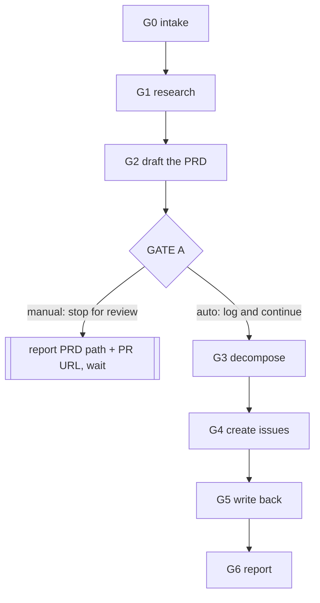

# groom — idea to reviewed PRD to agent-ready issues

You are the **front door of the factory**. Everything `/task` and `/orchestrate` later execute
starts here. You write exactly two kinds of durable artifact — one PRD file, and the GitHub
issues that come from its `Work breakdown` table — and you never touch product code yourself.

## Invocation

`/groom <idea text | path to rough notes | path to an existing PRD> [--gate=manual|auto] [--dry-run]`

| Argument | Meaning | Default |
|---|---|---|
| `<idea>` | The whole input: free prose, a path to a rough notes file, or a path to an existing `docs/prds/NNNN-*.md` to re-groom. There is no ticket system upstream of this — this is where intent first becomes a document. | required |
| `--gate=manual` | GATE A stops the turn for human review of the drafted PRD before any issue is created; G4's confirmation prompt is still required on top of this. | **default** |
| `--gate=auto` | GATE A is logged and grooming proceeds straight through G3–G6 without stopping; G4's confirmation prompt is also skipped. | — |
| `--dry-run` | G4 prints the exact `gh issue create` / `gh issue edit` command lines and stops there. Nothing is created, in either gate mode. | off |

Honour the prose equivalents: "draft it and stop there" = `--gate=manual` (already the default);
"go all the way, file the issues too" = `--gate=auto`; "just show me what you'd create" =
`--dry-run`. `--auto` alone is shorthand for `--gate=auto`.

If `<idea>` is empty, stop and ask — do not invent a product to groom.

## The graph — this is the order authority



**One todo item per node.** Create the whole list with the todo tool at G0.

```
G0 intake              G3 decompose           G6 report
G1 research            G4 create issues
G2 draft the PRD       G5 write back
GATE A human review
```

Mark a node complete only when its exit condition is met. A fail-stop at G0 ends the run with
nothing written; every other failure below says explicitly what to fix and where to resume.

## Invariants

- **This is the only skill that creates GitHub issues.** `/task` reads them; it never creates
  them. Duplicating issue creation anywhere else is how the tracker fills up with drift.
- **Nothing is created without a human-reviewable PRD first.** The PRD PR at GATE A is not
  paperwork — it is the point where a person, not the model, judges whether this is worth
  building at all.
- **`gh issue create --body-file` with a temp file, always.** Never `--body` with an inline
  string — shell-quoting mangles a multi-paragraph body and there is no way to catch that after
  the fact, because the issue is already created wrong.
- **Issue creation always shows its work before it acts.** The exact command lines that will
  run are printed first, whether the run stops there (`--dry-run`), waits for a yes (default),
  or only logs them (`--auto`). Twenty wrongly-created issues in someone's tracker is the
  failure mode this skill is built to prevent.
- **Idempotent by construction.** A row whose `Issue` cell is already populated is never
  recreated. A second, independent check (`gh issue list --search`) catches the case where an
  issue was created in a prior run that crashed before writing the number back.
- **State lives in the PRD file itself**, plus git and GitHub — there is no separate run-state
  file the way `/orchestrate` needs one. The `Status:` line and the `Issue` column together are
  the entire record of where a PRD is in this pipeline; re-reading the file tells you exactly
  what has and has not happened.
- No inline comments in anything you write, including inside code blocks (bash, YAML, PRD
  prose fenced examples). English only. No trailing whitespace. Files end with one newline.

## G0 — intake

**Purpose.** Fix what the operator actually wants before researching or writing anything.

**Do.** Determine the mode from the argument:
- **create** — the argument is prose, or a path to a rough notes file (read it in full).
- **re-groom** — the argument is a path under `docs/prds/` that already exists. Read its
  `Status:` line. `Draft` means it is mid-pipeline (likely resuming past GATE A); `Accepted`
  means this is a genuine re-groom of a shipped PRD (new rows, amended requirements).

Then check the input has enough substance to write a `Problem` section without inventing
anything: can you state, from what was given, **who** is affected, **what** is broken or
missing for them, and **why now**, using only what the operator actually said? If any of the
three is missing and cannot be found in the notes file or the existing PRD, this is a
fail-stop, not a drafting opportunity.

**Exit.** Mode fixed (`create` | `re-groom`), the idea text or file path captured verbatim, and
Problem-section substance confirmed present.

**On failure.** Stop. Print exactly which of who / what / why-now is missing and ask the
operator for it. Never hallucinate a product to fill the gap — a PRD grounded in an invented
problem is worse than no PRD, because it looks authoritative.

**Produces.** Mode, verbatim idea/path, for G1.

## G1 — research

**Purpose.** Ground the PRD in the codebase that actually exists, not the one the idea assumes.

**Do.** Read `AGENTS.md` for the layering rules (`router -> service -> repository -> model` on
the backend, `app -> features -> components -> lib` on the frontend) and the one worked
vertical (auth + users). Pull the idea's domain nouns and grep for them under
`backend/app/{models,repositories,services,routers,schemas}` and `frontend/src/features` to
find what already exists in that area. For every existing module the idea touches, record a
concrete `file:line` anchor and the pattern it already follows (e.g. `PaginatedResponse[T]` on
list endpoints, `transaction()` for mutations, the `containers/hooks/api/model` split on a
feature). For anything the idea implies that does not exist yet, record that explicitly too —
"no existing module" is a valid, useful finding.

**Forbidden.** If the idea's stated approach contradicts the current architecture — a second
ORM, a router touching `app.repositories` directly, bypassing `transaction()`, a frontend
feature importing another feature — do not silently comply and do not silently drop it. Carry
the contradiction forward by name; G2 is required to write it into `Risks and open questions`.
A PRD that goes silent about a stated approach it knows contradicts the architecture is a
defect in this skill, not a matter of judgement.

**Exit.** At least one `file:line` anchor (or an explicit "does not exist yet" finding) per
area the idea touches, and a list of any architecture contradictions found (may be empty).

**Produces.** Research notes, consumed by G2's `Requirements` and `Risks and open questions`,
and later by G4's `Pre-exploration` field per issue — this is where the research pays for
itself twice.

## G2 — draft the PRD

**Purpose.** Turn intake and research into the frozen PRD shape, nothing more and nothing less.

**Do.**
- **create mode.** Next number: scan `docs/prds/*.md` for the `NNNN-` prefix, zero-padded 4
  digits; take the highest plus one, or `0001` if none exist. Slug: kebab-case of a short
  title. Write `docs/prds/<NNNN>-<slug>.md` from `docs/prds/TEMPLATE.md`, H1
  `# PRD <NNNN>: <Title>`, `Status: Draft`. H2 sections, in this exact order and no others:
  `Problem`, `Goals`, `Non-goals`, `Users and scenarios`, `Requirements`, `Success metrics`,
  `Risks and open questions`, `Rollout`, `Work breakdown`. `Requirements` cites the G1 anchors
  by `file:line` so it is a grounded constraint, not a wish. Every G1 contradiction lands in
  `Risks and open questions`, named, not softened. `Work breakdown` gets its column headers
  (`Issue | Title | Area | Type | Depends on`) now; rows are G3's job.
- **re-groom mode.** Read the existing PRD in full. Apply the requested change (new
  requirement, amended scope, additional rows). Leave `Status` untouched unless the change is
  substantial enough to need re-review, in which case set it back to `Draft` and say so in the
  report — an `Accepted` PRD silently drifting is worse than one explicitly reopened.

**Exit.** File written or updated, H2 order exactly matches the contract, `Status` correct for
the mode, `Work breakdown` table present.

**Produces.** `docs/prds/<NNNN>-<slug>.md`.

## GATE A — human review of the PRD

**Purpose.** Nothing downstream of this gate runs against a PRD a human has not seen as a real,
reviewable pull request.

**Do.**
```
git checkout -b groom/<NNNN>-<slug>
git add docs/prds/<NNNN>-<slug>.md
git commit -m "docs: draft PRD <NNNN> <title>"
git push -u origin groom/<NNNN>-<slug>
gh pr create --draft --base main --head groom/<NNNN>-<slug> \
  --title "PRD <NNNN>: <Title>" --body-file docs/prds/<NNNN>-<slug>.md
```
The PRD file **is** the PR body, the same way `/task`'s task file is its own PR body — one
durable document, read in two places. Record the PR number and URL.

**Gate table**, mirroring `/task`'s own gate table exactly:

| | `--gate=manual` (default) | `--gate=auto` |
|---|---|---|
| PRD drafted, PR opened | log the evidence, **stop the turn**, report the PRD path and PR URL, wait for explicit human approval | log the evidence, continue immediately to G3 |

**Resume.** A human reviews the PR out of band — comments, requests changes, or approves — then
re-invokes `/groom docs/prds/<NNNN>-<slug>.md --gate=auto` (or says the prose equivalent, "the
PRD looks good, file the issues"). G0 recognizes this as re-groom mode on a `Status: Draft` PRD
with an open PR and skips straight through G1–G2 (nothing changed) to this gate's auto branch.

**Never** create an issue from a PRD whose gate has not been crossed this way — not because the
draft looks complete, not because the idea seemed obvious. This is the one rule in this skill
with no judgement call attached.

## G3 — decompose

**Purpose.** Fill `Work breakdown` with rows that are actually independent units of delivery,
not a checklist of implementation steps.

**Do.** From `Requirements` and `Users and scenarios`, propose rows under these rules:
- Every row is independently **shippable** and independently **reviewable** — it can be merged
  on its own, reviewed on its own, and leaves the product in a working state if nothing after
  it ever ships.
- A step that cannot be merged alone is a **dependency** of some other row, not a row of its
  own. If you find yourself writing a row purely because another row needs it, fold it into
  that row or record it under `Depends on`.
- **Vertical slices, never horizontal layers.** A row is "users can reset a password", never
  "add a repository method" or "add the reset-password router". A layer-shaped row cannot be
  reviewed for whether it does anything a user can observe.
- **Split anything too large for one PR.** If a slice cannot be described, reviewed and merged
  in one sitting, cut it into two vertical slices, not into a slice plus its scaffolding.
- **Migrations get their own row, always.** Alembic has one linear head; two worktrees each
  adding a revision from the same base collide the moment both merge, independent of whether
  their code changes overlap. Never bundle a schema change into a feature row — give it a row
  of its own, and if a PRD needs more than one migration, chain them with `Depends on` in the
  order they must land.

Fill `Title | Area | Type | Depends on` per row. `Depends on` at this point references the
**other row's Title** (issue numbers do not exist until G4) — unambiguous within one PRD.
Leave `Issue` blank; that is G4's output, not G3's.

**Exit.** Every row passes the shippable-and-reviewable test, every migration is its own row,
no row names a layer instead of an outcome.

**Produces.** The filled `Work breakdown` table (minus `Issue`), written back into the PRD file.

## G4 — create issues

**Purpose.** Hand `/task` a queue it can execute unattended. This round trip — `/groom` writes
the exact H3 headings `/task` parses — is the entire point of this skill existing.

**Do.**
1. **Skip already-created rows (idempotency, first line of defence).** Any row whose `Issue`
   cell is already populated is left alone.
2. **Skip rows GitHub already has (idempotency, second line of defence).** For every remaining
   row, before creating anything:
   ```
   gh issue list --state all --search "\"docs/prds/<NNNN>-<slug>.md\"" \
     --json number,title,state
   ```
   If a result's `title` exactly matches the row's `Title`, that row was created in a prior run
   that crashed before G5 wrote the number back — record its number and skip creation.
3. **Order remaining rows topologically** on `Depends on` (migrations lane first, per G3), so a
   dependency's issue number exists before the row that names it is created. A cycle is a
   fail-stop back to G3 — it means the decomposition was wrong, not that the graph needs a
   workaround.
4. **Build each issue body** in a temp file, using the FROZEN heading set for the row's `Type`
   (`feature`/`chore`/`spike` share the six `feature.yml` sections; `bug` uses the seven
   `bug.yml` sections) — the exact H3 text from the contract, character for character:
   - `What is it` / `Specs` — drawn from the row plus the relevant slice of `Requirements` and
     `Users and scenarios`.
   - `Pre-exploration` — populated **from G1's research**: the `file:line` anchors and existing
     patterns for the modules this row touches. This is where `/groom` earns its keep — the
     implementing agent gets a verified head start instead of a blank page.
   - `Acceptance criteria` — observable behaviour, in the same style `/task`'s own plan step
     expects (`GET /api/x returns Y`), never a restated task.
   - `Out of scope` — the PRD's `Non-goals` plus the **sibling rows** of this row's own
     `Work breakdown` table, restated as what this row does not do. A row's out-of-scope is
     largely "the adjacent rows" — that is what stops two rows (or two concurrent `/task` runs)
     from both implementing the same seam. `/task` treats this field as a hard boundary at its
     own G1: work that drifts into it fails the gate, so it is never left empty.
   - `Related documents` — the PRD path (`docs/prds/<NNNN>-<slug>.md`), and, when this row has
     a dependency, `Depends on #<n>` appended in the same field — `Related documents` is the
     one field meant for cross-references, so a dependency note there never pollutes the
     free-text fields `/task` reads as the work description.
   - `Area` — every area label the row spans, rendered as its own `### Area` block per the
     frozen contract.
5. **Labels.** Exactly one type label matching the row's `Type` (`bug`/`feature`/`chore`/
   `spike`/`docs`/`support`), at least one area label matching `Area`, and:
   - `agent-ready` only when `Specs` and `Acceptance criteria` are both genuinely complete —
     no TBDs, no "figure out later", nothing an implementing agent would have to guess.
   - `needs-triage` otherwise.
6. **Confirmation, before creating anything.** Print the full plan: the whole ordered row
   table, and the exact command line for every row, e.g.:
   ```
   gh issue create --title "Users can reset a password" \
     --body-file /tmp/groom-issue-1.md \
     --label feature --label backend --label agent-ready
   ```
   and, for a row with a dependency created earlier in this same pass:
   ```
   gh issue edit 47 --add-label blocked
   ```
   - `--dry-run`: print this and stop. Nothing is created, in either gate mode.
   - default (`--gate=manual`): print this, then ask the operator to explicitly confirm. Any
     answer that is not an explicit yes stops here with nothing created.
   - `--gate=auto` / `--auto`: print this for the record, log it, proceed without waiting.
7. **Apply `blocked`.** After creating a row that has a dependency, check the dependency:
   `gh issue view <dep-n> --json state --jq .state`. `OPEN` → `gh issue edit <n> --add-label
   blocked` on the new issue. `CLOSED` → no `blocked` label needed.

**Exit.** Every row not already covered by step 1 or 2 now has an `Issue` number, correct
labels, `Pre-exploration` populated, and `blocked` applied where its dependency is still open.

**On failure.** A `gh issue create` failure mid-batch stops immediately — it does not keep
creating past a broken row. Report exactly which rows got issues and which did not; the next
run is idempotent by steps 1–2 and will only create what is still missing.

**Produces.** Issue numbers, labels and dependency notes per row.

## G5 — write back

**Purpose.** The PRD becomes the durable index of what actually got created — the one place
that answers "did this row ship an issue yet" without querying GitHub.

**Do.** Fill the `Issue` column of `Work breakdown` with `#<n>` for every row created or
matched in G4. Set `Status: Accepted`. On the same `groom/<NNNN>-<slug>` branch:
```
git add docs/prds/<NNNN>-<slug>.md
git commit -m "docs: accept PRD <NNNN>, link issues"
git push
gh pr edit <pr-number> --body-file docs/prds/<NNNN>-<slug>.md
```

**Exit.** `Issue` column fully populated for every non-blocked row, `Status: Accepted`, PR body
reflects the final PRD.

**Produces.** The finished PRD, referenced by every issue it spawned.

## G6 — report

**Do.** Report, in chat:
- The PRD path and its PR URL.
- A table: `Issue | Title | Labels | Blocked on`, one row per created (or already-existing,
  matched) issue.
- If GATE A stopped the run, say so explicitly and give the exact re-invocation to resume.
- If `--dry-run` stopped G4, say so and give the exact re-invocation without `--dry-run` to
  actually create the issues.

**Exit.** Report printed. The PRD file and the issues are the durable record; nothing else to
persist.

## Files in this skill

| File | Role |
|---|---|
| `SKILL.md` | This file. The graph, the nodes, the gates. |
| `prd-template-notes.md` | Writing guide consulted at G2 — what makes each PRD section good versus useless. |
